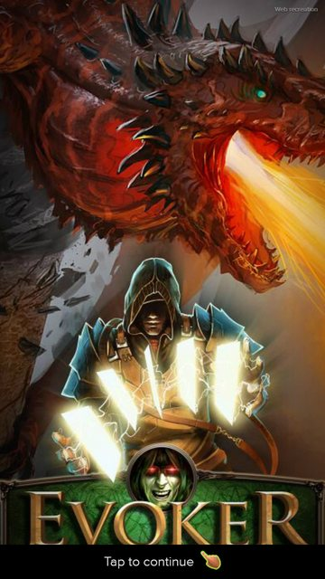
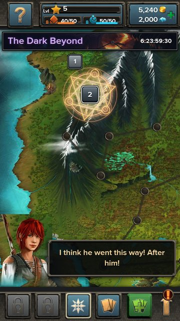
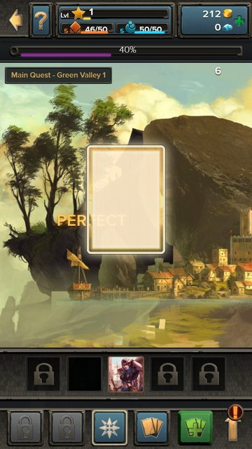
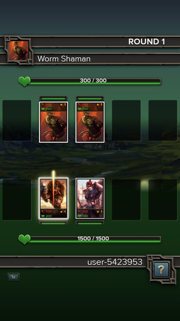
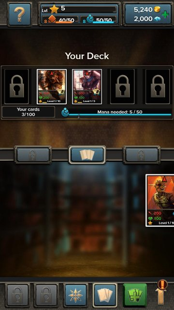
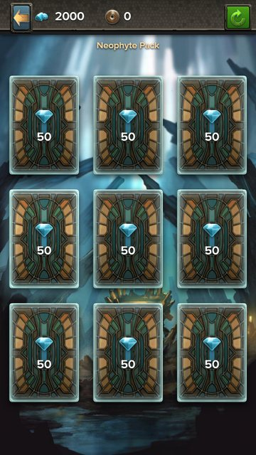
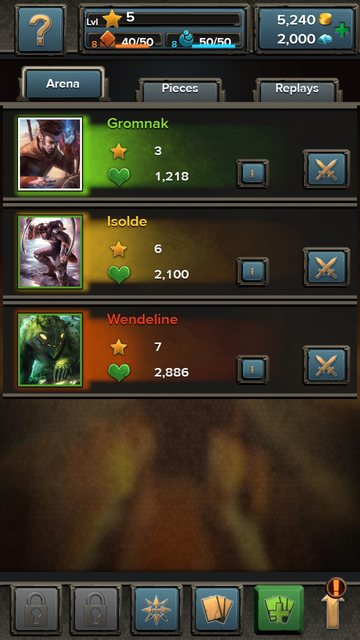
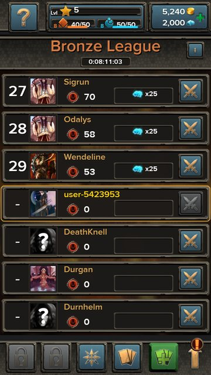

<div align="center">

# Evoker

**A faithful recreation of a card battler whose servers went dark in 2018, rebuilt for the browser from the original client, fan archives and gameplay footage.**

[**Play it now**](https://evoker.pages.dev) &nbsp;·&nbsp; no install, no account, your progress stays in your browser

<br>

    

   

</div>

---

## What this is

**Evoker** was a mobile collectible card game by flaregames (2013 to 2018): five-card line-ups that fight automatically, 200 cards to collect and evolve, quests, an arena, a daily league. When the servers closed the game became unplayable overnight.

This repository brings it back as a **single-player web game**:

- The whole game runs in the browser. There is no backend; the save lives in the browser's local storage and can be exported as a file.
- The **battle engine is a literal port of the original client's simulator**, recovered from the Lua bytecode inside the Android package, so every fight resolves exactly as it did in 2016, down to the order of deaths and heals.
- The **original art, fonts, sounds, animations and texts** are used directly. The 195 cards, their stats, prices and quests were reconstructed from the fan wiki, archived store pages, screenshots and gameplay videos, and every rule and number is written down in the design documents.
- The opening cinematic, the scripted first fight and the first-session tutorial follow the original frame by frame.

## Features

| Area | What you get |
|---|---|
| Quests | 100 main quests across the painted world map, 8 portals of 25 quests each, boss intros and showdowns |
| Cards | 195 cards with five evolution stages, training, fusion, card pieces, set collections |
| Fights | Automatic five-on-five battles with abilities, tribe bonus, reflects, revives, stuns, the original effects and sounds |
| Arena & League | Simulated opponents with their own decks, card-piece hunts, a daily league with promotion and prizes |
| Economy | Gold, gems, stamina and mana potions, boosters, daily rewards and events, the original prices |
| Polish | The intro video, the tutorial guide, level-up and unlock popups, phone-style drag scrolling, a Card Lab to test any card |

## How it is built

- **Vanilla JavaScript, zero dependencies, no build step.** ES modules served as static files; what you see in the repository is what runs.
- **Pure, deterministic game logic.** Every game function is `(state, deps, now, args) -> state` with a seeded random generator and an injected clock, which makes fights replayable and the whole game testable without a browser.
- **A test pyramid built from scratch:** 678 unit tests (the engine replays the original client's own test fights round by round), an end-to-end suite and a 30-step smoke test driven through a hand-written Chrome DevTools Protocol client, and long QA playtests that grind the economy for hours.
- **Research as a first-class artefact.** The unpacked client, the wiki dump, the video notes and every decision live next to the code, so each number in the game can be traced to its source.
- **Hosting:** a static deploy to Cloudflare Pages, one command.

## iOS: under development

An iPhone version lives in `Evoker iOS/`. What installs on the phone today is the **web game in a native shell**: a WKWebView serving the bundled game through a custom URL scheme, with the save mirrored to the app's storage, so it plays exactly like the browser version and picks up every web fix with the next build.

A **full native rewrite** (SwiftUI menus and deck building, SpriteKit battles, the game logic in its own Swift package with golden tests recorded from the web version) is in progress and not yet the shipped app. The web version is the reference implementation; the iOS port follows it.

## Run it locally

```sh
cd "Evoker Web"
npm start            # http://localhost:8080/
npm test             # the unit suite, about 8 seconds
npm run test:e2e     # the browser suite (needs Edge or Chrome)
```

Node 18 or newer, nothing to install.

## Cheats

There are a few easter eggs for anyone who wants to skip the grind. Open the browser console (F12) while the game is running and type `cheats.help()`: it lists every cheat, from unlimited gold to any card by name.

## Repository layout

```
Evoker Web/     the game: src/ (core, engine, game, ui), data/, assets/, tests/, docs/design/, exploration/
Evoker iOS/     the iPhone app: the EvokerWeb shell (ships) and the native rewrite (in progress)
screenshots/    the images above
```

## Credits and disclaimer

Evoker was created by flaregames. This project was made out of love for a game I had lost in the past: the servers closed and nothing was left to play. It is a non-commercial fan recreation made so the game can still be played; all original art, sounds, names and texts belong to their owners, and the project is not affiliated with or endorsed by flaregames. The reconstruction relied on the Evoker fan wiki and on the players who recorded their games.

Built by Guilherme Bandeira Costa.
